<div align="center">

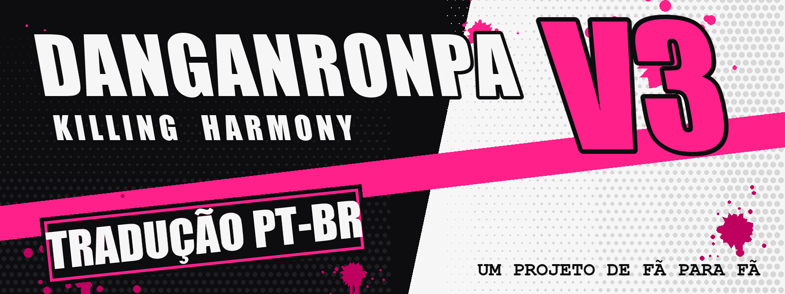

<br>

<a href="https://github.com/igorwingert/Danganronpa-V3-PTBR/releases"></a>


<a href="https://github.com/igorwingert/Danganronpa-V3-PTBR/releases"></a>


<br><br>

**Um projeto de fã para fã.**<br>
Tradução não oficial e gratuita de *Danganronpa V3: Killing Harmony* (PC/Steam) para português brasileiro.<br>
Instalador de 1 clique: escolhe a pasta, instala e joga pela Steam. Dá pra desinstalar quando quiser.

<br>

<a href="https://github.com/igorwingert/Danganronpa-V3-PTBR/releases"></a>

</div>

<br>

> [!IMPORTANT]
> ***Puhuhu...*** **Esta é uma versão beta!** A história está traduzida do começo ao fim, mas ainda **precisa de testes**.
> O prólogo e o capítulo 1 já foram jogados e revisados; do capítulo 2 em diante, ainda não.
> Achou algo estranho? Chama no Discord **okarma.** ou [abra uma issue](https://github.com/igorwingert/Danganronpa-V3-PTBR/issues).

<br>

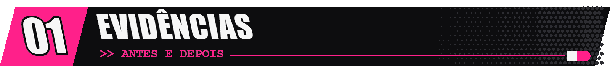

<div align="center">

As imagens com texto foram redesenhadas no estilo do original: mesma fonte (ou a mais parecida possível), cor, brilho e textura.

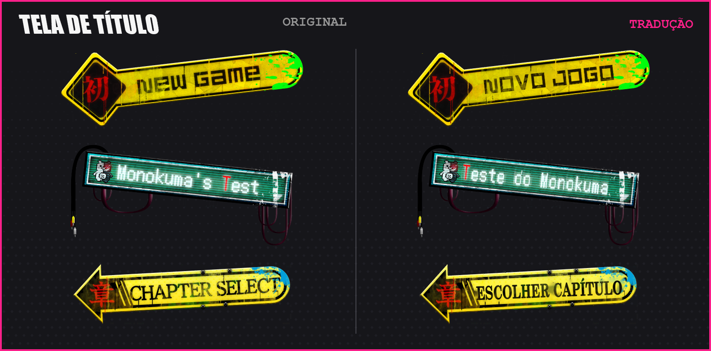

<table>
<tr>
<td width="50%">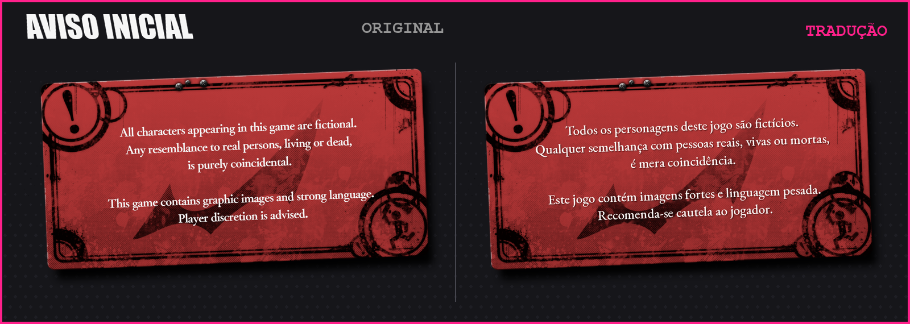</td>
<td width="50%">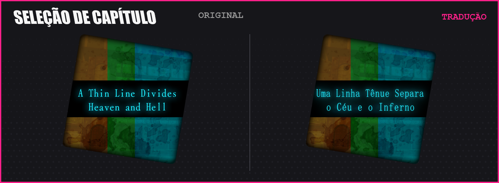</td>
</tr>
<tr>
<td width="50%">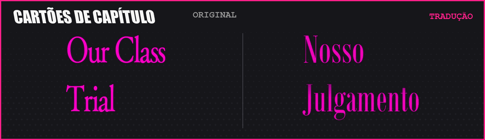</td>
<td width="50%">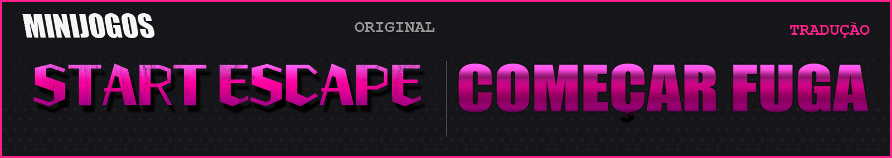</td>
</tr>
</table>

</div>

<br>

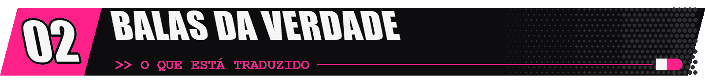

| | Parte | Tradução | Testado no jogo |
|:-:|---|:-:|:-:|
| 🩷 | **Prólogo** | ✅ | ✅ |
| 🩷 | **Capítulo 1** | ✅ | ✅ |
| 🩷 | **Capítulos 2 a 6** (com todos os julgamentos) | ✅ | 🔍 em teste |
| 🩷 | **Epílogo** | ✅ | 🔍 em teste |
| 🩷 | **Tempo Livre** e **Amor Através do Universo** | ✅ | 🔍 em teste |
| 🩷 | **Interface:** menus, opções, Balas da Verdade, Mentiras, presentes, habilidades, mapa, nomes de objetos | ✅ | 🔍 em teste |
| 🩷 | **Fonte com acentos** (á, ã, ç, ê...) nos diálogos e no julgamento | ✅ | ✅ |
| 🩷 | **Imagens com texto:** tela de título, aviso inicial, cartões de capítulo, julgamento, ajuda, Monopad | 🟨 a maior parte | 🔍 em teste |
| 🖤 | **Plano de Desenvolvimento de Talentos** e **Teste do Monokuma** | ❌ ainda não | — |

<sub>~70 mil falas traduzidas no total. Glossário consistente com os termos do jogo: Balas da Verdade, Debate Sem Parar, Arquivo Monokuma, Supremo/Suprema...</sub>

<br>

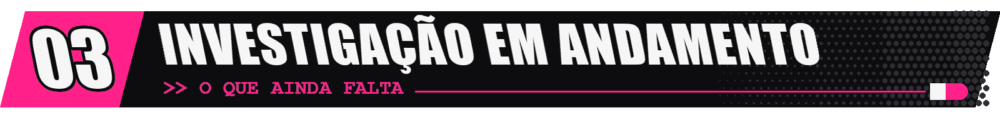

- 🔍 **Testes do capítulo 2 em diante.** Se for jogar, sua ajuda reportando erros vale muito!
- 🎲 **Plano de Desenvolvimento de Talentos** e **Teste do Monokuma** (o modo bônus estilo tabuleiro/RPG): ainda em inglês.
- 💥 Os quadrinhos do Argumento Final (onomatopeias) e algumas imagens menores.
- 🎬 Vídeos, como a abertura do *Class Trial Resume*.

<br>

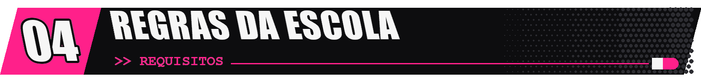

> **Regra nº 1:** Ter *Danganronpa V3: Killing Harmony* original **para PC (Steam)**.<br>
> **Regra nº 2:** Usar Windows.<br>
> **Regra nº 3:** Deixar o idioma do jogo na Steam em **inglês** (é o padrão).<br>
> **Regra nº 4:** Ter uns **200 MB livres** no disco do jogo.<br>
> **Regra nº 5:** **Fechar o jogo** antes de instalar.<br>
> <sub>*Quem violar as regras vai ver o jogo em inglês. Puhuhu!*</sub>

<br>

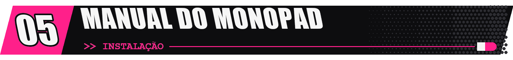

### 🎮 Jeito fácil: instalador (recomendado)

**1.** Baixe o **`Instalador_DRV3_PTBR_vX.X.X.exe`** na [última versão](https://github.com/igorwingert/Danganronpa-V3-PTBR/releases).

**2.** Abra o instalador. Ele acha a pasta do jogo sozinho; se não achar, clique em <kbd>Procurar...</kbd> e escolha a pasta onde fica o `Dangan3Win.exe`.<br>
<sub>Pra achar a pasta: na Biblioteca da Steam, botão direito no jogo → **Gerenciar** → **Ver arquivos locais**.</sub>

**3.** Clique em <kbd>INSTALAR TRADUÇÃO</kbd> e espere menos de um minuto.

**4.** Pronto! **Abra o jogo pela Steam normalmente.** 🎉

> [!NOTE]
> **"O Windows protegeu o computador"?** É o aviso padrão para programas sem assinatura digital paga. Clique em **Mais informações** → **Executar assim mesmo**.
> O código do instalador está aberto aqui no repositório, na pasta [`instalador`](instalador).

<details>
<summary><b>Como o instalador funciona (e como desinstalar)</b></summary>
<br>
<ul>
<li>Ele troca os textos e imagens dentro dos arquivos <code>.cpk</code> do jogo e muda o índice para apontar para eles.</li>
<li>Antes, ele guarda uma cópia de tudo que vai ser trocado em <code>data\win\ptbr_backup</code> (uns 180 MB). <b>Nada do jogo original se perde.</b></li>
<li><b>Desinstalar:</b> abra o instalador e clique em <kbd>DESINSTALAR</kbd>. Os arquivos voltam a ser exatamente os originais.</li>
<li><b>Atualizar:</b> baixe o instalador novo e clique em instalar; ele troca a versão antiga sozinho.</li>
<li>Se a Steam <b>verificar a integridade dos arquivos</b> ou atualizar o jogo, a tradução some. É só rodar o instalador de novo.</li>
<li>Seus saves continuam funcionando normalmente.</li>
</ul>
</details>

### 🧩 Pra quem já usa mods: Reloaded-II

<details>
<summary><b>Instalar como mod do Reloaded-II (não altera nenhum arquivo do jogo)</b></summary>
<br>

**1.** Instale o [Reloaded-II](https://github.com/Reloaded-Project/Reloaded-II/releases/latest) (`Setup.exe`). Se ele pedir pra instalar o .NET, aceite.<br>
**2.** No Reloaded-II, clique no <kbd>+</kbd> (*Add an Application*) e escolha o `Dangan3Win.exe`.<br>
**3.** Baixe o **`DRV3_PTBR_vX.X.X.zip`** da [última versão](https://github.com/igorwingert/Danganronpa-V3-PTBR/releases) e **arraste pra janela do Reloaded-II**. Aceite baixar o **CRI FileSystem V2 Hook** se ele perguntar.<br>
**4.** Marque **Danganronpa V3 - Tradução PT-BR** na lista de mods e clique em <kbd>Launch Application</kbd>.

Nesse modo, abra o jogo **sempre pelo Reloaded-II** (pela Steam ele abre em inglês). Pra desinstalar, é só desmarcar o mod.<br>
<sub>Não use os dois jeitos ao mesmo tempo: escolha o instalador **ou** o Reloaded-II.</sub>
</details>

<br>

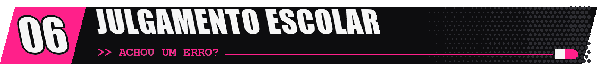

**Achou uma contradição? Atire sua Bala da Verdade!** 🎯

Chama no Discord **`okarma.`** ou abra uma [**issue**](https://github.com/igorwingert/Danganronpa-V3-PTBR/issues) com:

- 📍 **onde aconteceu:** capítulo e cena (ex.: *"cap. 3, julgamento, Debate Sem Parar do Kiyo"*);
- 💬 **o texto errado**, copiado ou em print;
- 📸 se for uma frase cortada ou saindo da caixa, **um print ajuda muito**.

Sugestões de tradução, nomes e termos também são bem-vindas.

<br>

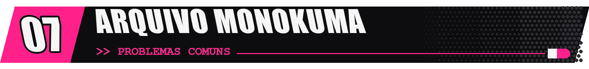

<details>
<summary><b>📁 Arquivo Monokuma 1:</b> o jogo continua em inglês</summary>
<br>
<ul>
<li>Abra o instalador e veja se ele mostra <b>"Tradução instalada"</b>. Se não, clique em instalar.</li>
<li>Se a Steam verificou ou atualizou os arquivos do jogo, a tradução é removida: rode o instalador de novo.</li>
<li>Confira se o idioma do jogo na Steam está em <b>inglês</b>.</li>
<li>Usando o Reloaded-II: abra o jogo <b>pelo Reloaded-II</b> e confira se o mod e o <b>CRI FileSystem V2 Hook</b> estão marcados.</li>
</ul>
</details>

<details>
<summary><b>📁 Arquivo Monokuma 2:</b> o Windows ou o antivírus bloqueou o instalador</summary>
<br>
É um alarme falso comum em programas pequenos sem assinatura digital paga. No aviso azul do Windows, clique em <b>Mais informações</b> → <b>Executar assim mesmo</b>.
Se preferir, use o jeito do Reloaded-II, que não precisa de instalador. O código do instalador está na pasta <a href="instalador"><code>instalador</code></a>.
</details>

<details>
<summary><b>📁 Arquivo Monokuma 3:</b> "o Windows não deixou alterar os arquivos do jogo"</summary>
<br>
Feche o jogo (e a Steam, se precisar) e tente de novo. Se o jogo estiver numa pasta protegida, o instalador oferece reabrir como administrador: aceite.
</details>

<details>
<summary><b>📁 Arquivo Monokuma 4:</b> o jogo não abre pelo Reloaded-II</summary>
<br>
Atualize o Reloaded-II e o CRI FileSystem V2 Hook (o Reloaded tem um botão de verificar atualizações).
</details>

<details>
<summary><b>📁 Arquivo Monokuma 5:</b> acentos aparecendo errado</summary>
<br>
Desative outros mods que troquem a fonte do jogo.
</details>

<br>

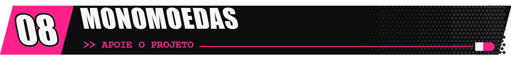

A tradução é e sempre vai ser **gratuita**. Se ela te ajudou a curtir o jogo e você quiser apoiar o trabalho, qualquer Monomoeda ajuda! 🪙

<div align="center">

**Pix (chave aleatória)**

```
34c77f00-5644-4e0f-ade6-2e7f328e8440
```

<sub>Apoio é opcional e não libera nada a mais: todo mundo recebe a mesma tradução.</sub>

</div>

<br>

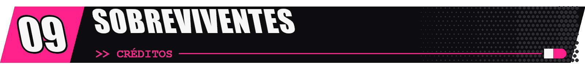

| | |
|---|---|
| **Tradução e revisão** | Igor · Discord `okarma.` |
| **Reloaded-II** e **CRI FileSystem V2 Hook** | [Sewer56](https://github.com/Sewer56) e contribuidores |
| **Fontes livres (SIL OFL)** usadas nas imagens | Cinzel, Marcellus, Special Elite, EB Garamond, Zhi Mang Xing, Kaushan Script |

<br>

<div align="center">

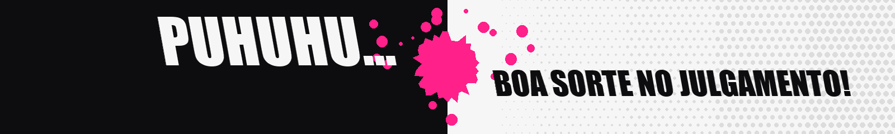

<sub>Projeto de fã, sem relação com a Spike Chunsoft ou a NIS America. Danganronpa é marca registrada da Spike Chunsoft.<br>
**É preciso ter o jogo original:** este mod não inclui o jogo, só os textos e imagens traduzidos. Se você gosta da série, compre os jogos oficiais!</sub>

</div>
