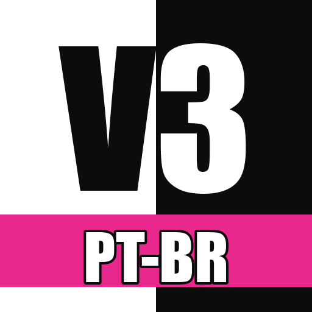

# Danganronpa V3: Killing Harmony — Tradução PT-BR

**Um projeto de fã para fã.** Tradução não oficial e gratuita de Danganronpa V3: Killing Harmony (PC/Steam) para português brasileiro.
Instala como mod do **Reloaded-II**, sem mexer nos arquivos do jogo, e dá pra desligar quando quiser.

> **Versão atual: 0.9.0-beta.** A história está traduzida do começo ao fim, mas ainda **precisa de testes**: o prólogo e o capítulo 1 já foram jogados e revisados; do capítulo 2 em diante, ainda não.
> Achou erro de texto, frase cortada ou qualquer coisa estranha? Avise no Discord (**okarma**) ou [abra uma issue](https://github.com/igorwingert/Danganronpa-V3-PTBR/issues).

**[⬇ Baixar a última versão](https://github.com/igorwingert/Danganronpa-V3-PTBR/releases/latest)**

## O que está traduzido

- **História completa:** prólogo, capítulos 1 a 6 e epílogo, com todos os diálogos e julgamentos
- **Tempo Livre** e **Amor Através do Universo** (Love Across the Universe)
- **Interface:** menus, opções, Balas da Verdade, Mentiras, presentes, habilidades, mapa, nomes de objetos e locais
- **Fonte com acentos** (á, ã, ç, ê...) nos diálogos e nos minijogos do julgamento
- **Imagens com texto:**
  - tela de título, seleção de capítulo e dificuldade
  - aviso inicial e cartões de capítulo
  - banners e minijogos do julgamento (Debate Sem Parar, Choque de Lâminas, Argumento Final etc.)
  - telas de ajuda e Monopad

## O que ainda falta

- **Testes do capítulo 2 em diante.** Se for jogar, sua ajuda reportando erros vale muito!
- **Plano de Desenvolvimento de Talentos** e **Teste do Monokuma** (o modo bônus estilo tabuleiro/RPG): ainda em inglês
- Os quadrinhos do Argumento Final (onomatopeias) e algumas imagens menores
- Vídeos (por exemplo, a abertura do "Class Trial Resume")

## Requisitos

- Danganronpa V3: Killing Harmony **para PC (Steam)**, original
- Windows
- [Reloaded-II](https://github.com/Reloaded-Project/Reloaded-II/releases/latest) (gerenciador de mods gratuito)

## Instalação

1. **Instale o Reloaded-II.** Baixe o `Setup.exe` da [página de releases](https://github.com/Reloaded-Project/Reloaded-II/releases/latest) e rode. Se ele pedir pra instalar o .NET, aceite.
2. **Adicione o jogo.** No Reloaded-II, clique no **+** (*Add an Application*) e escolha o `Dangan3Win.exe` na pasta do jogo.
   Pra achar a pasta pela Steam: botão direito no jogo → Gerenciar → Ver arquivos locais.
3. **Instale a tradução.** Baixe o `DRV3_PTBR_vX.X.X.zip` da [última versão](https://github.com/igorwingert/Danganronpa-V3-PTBR/releases/latest) e **arraste o zip pra janela do Reloaded-II**.
   - Se ele perguntar sobre baixar dependências, aceite. A tradução precisa do **CRI FileSystem V2 Hook**, e o Reloaded baixa sozinho.
   - Sem arrastar: extraia o zip dentro da pasta `Mods` do Reloaded-II, para ficar `Reloaded-II\Mods\DRV3_PTBR\ModConfig.json`.
4. **Ative o mod.** Clique no jogo na lateral esquerda do Reloaded-II e marque **Danganronpa V3 - Tradução PT-BR** na lista de mods.
5. **Jogue pelo Reloaded-II.** Clique em **Launch Application**. Daí em diante, abra o jogo sempre por ele. Se abrir direto pela Steam, o jogo vem em inglês.
6. **O idioma do jogo na Steam precisa estar em inglês** (é o padrão). A tradução substitui os textos em inglês.

Seus saves continuam funcionando: a tradução só troca textos e imagens.

### Desinstalar
Desmarque o mod no Reloaded-II, ou abra o jogo direto pela Steam. Nenhum arquivo do jogo é alterado.

### Atualizar
Baixe o zip novo e arraste pro Reloaded-II do mesmo jeito. Ele substitui a versão antiga.

## Reportar erros

Fale comigo no **Discord: okarma** ou abra uma [issue](https://github.com/igorwingert/Danganronpa-V3-PTBR/issues) com:
- **onde aconteceu:** capítulo e cena (ex.: "cap. 3, julgamento, Debate Sem Parar do Kiyo");
- **o texto errado**, copiado ou em print;
- se for uma frase cortada ou saindo da caixa, **um print ajuda muito**.

Também vale sugestão de tradução, nome de personagem ou termo estranho.

## Problemas comuns

- **O jogo continua em inglês:** confira se abriu pelo Reloaded-II, se o mod está marcado e se o **CRI FileSystem V2 Hook** aparece na lista de mods (ele é ativado automaticamente).
- **O jogo não abre pelo Reloaded:** atualize o Reloaded-II e o CRI FileSystem V2 Hook (botão de verificar atualizações no Reloaded).
- **Acentos aparecendo errado:** desative outros mods que troquem a fonte do jogo.

## Apoie

A tradução é e sempre vai ser **gratuita**. Se ela te ajudou a curtir o jogo e você quiser apoiar o trabalho, qualquer valor ajuda:

- [LINK DE APOIO]

## Créditos

- **Tradução e revisão:** Igor (Discord: okarma)
- Ferramentas da comunidade: [Reloaded-II](https://github.com/Reloaded-Project/Reloaded-II) e [CRI FileSystem V2 Hook](https://github.com/Sewer56/CriFs.V2.Hook.ReloadedII), de Sewer56 e contribuidores
- Fontes livres (SIL OFL) usadas nas imagens: Cinzel, Marcellus, Special Elite, EB Garamond, Zhi Mang Xing, Kaushan Script

## Aviso

Projeto de fã, sem relação com a Spike Chunsoft ou a NIS America.
Danganronpa é marca registrada da Spike Chunsoft. **Você precisa ter o jogo original**: este mod não inclui o jogo, só os textos e imagens traduzidos.
Se você gosta da série, compre os jogos oficiais.
